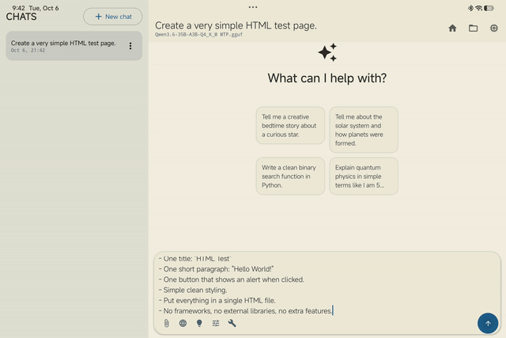
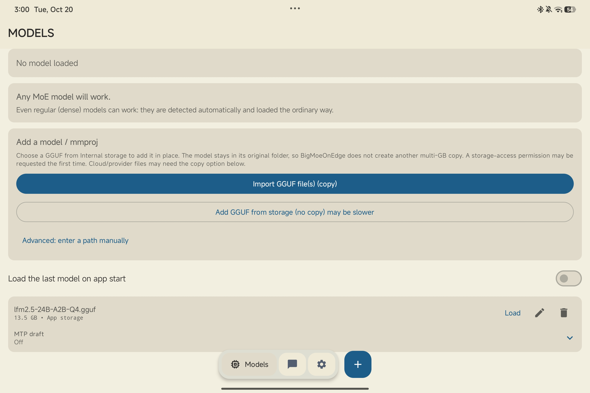

<p align="center">
  
</p>

<h1 align="center">BigMoeOnEdge+</h1>

<p align="center">
  An Android chat app for running local GGUF models on-device, especially large Mixture-of-Experts models.
</p>

<p align="center">
  <a href="https://github.com/hamodexd217/BigMoeOnEdge-plus/releases/latest">Download</a>
  ·
  <a href="https://github.com/hamodexd217/BigMoeOnEdge-plus/issues">Issues</a>
  ·
  <a href="docs/STATUS.md">Project status</a>
</p>

<p align="center">
  <a href="https://github.com/hamodexd217/BigMoeOnEdge-plus/releases"></a>
  <a href="LICENSE"></a>
  <a href="https://github.com/hamodexd217/BigMoeOnEdge-plus/stargazers"></a>
</p>

---

# BigMoeOnEdge+ (BigMoeOnEdge Plus / BigMoeOnEdge-plus)

> BigMoeOnEdge+ is a modified/enhanced fork of [BigMoeOnEdge](https://github.com/Helldez/BigMoeOnEdge).

> **Disclosure:** this fork was VERY HIGHLY developed with the help of AI tools.

> **Project update:** v0.5.8 hardens the optional Hexagon/NPU Android build workflow and validates the staged/packaged libraries; v0.5.7 expands and reorganizes the actual Engine Performance settings, wires batch-thread/ubatch/NPU/MoE controls through JNI, and enables overlap by default for new installs. v0.5.6 added the device-backed routing fix; v0.5.5 introduced incremental split-GGUF import. This source revision has not yet produced an APK in this environment.

## What is BigMoeOnEdge+?

BigMoeOnEdge+ is an Android chat application built on a customized **BigMoeOnEdge** native inference engine (0.28.1 compatibility revision; not a wholesale upstream 0.33.x replacement).

The engine is designed for Mixture-of-Experts models whose weights are read from flash storage during generation, which makes models larger than the device's RAM practical to run. The app wraps that engine in a complete chat experience: persistent conversations, reasoning display, web search, tools, attachments, multimodal input, artifacts, a workspace, and generation telemetry.

Dense GGUF models are supported through the normal loading path.

## Demo

A quick look at the artifact workflow:



More screenshots and demo media are in [`docs/assets`](docs/assets).

## Screenshots

<p align="center">
  
</p>

The model manager loads GGUF models and `mmproj` projector files, detects whether a model is Mixture-of-Experts or dense, and groups standard split GGUF shards into one model entry.

## Highlights

| Area | Details |
| --- | --- |
| Local inference | GGUF models through the native BigMoeOnEdge engine |
| Model support | Mixture-of-Experts and dense models; incremental multi-shard GGUF import with persisted incomplete states and metadata validation |
| Conversations | Persistent Room-backed chats, with per-chat drafts |
| Generation | Live token streaming and a stop control |
| Reasoning | Streaming "Thinking" / reasoning display |
| Web | Web search with model-generated search queries in automatic mode, plus optional Wikimedia Commons image search |
| Tools | File, code, web, and utility tools behind an approval flow |
| Attachments | Text, code, archives, documents, images, and video |
| Vision | `mmproj` support for multimodal models |
| Artifacts | Interactive HTML, SVG, Mermaid preview, and copyable/highlighted source code; HTTP(S) links open externally; Python is code-only, not executed |
| Workspace | Browse, open, edit, save, copy, share, and download generated files |
| Chat controls | Edit and copy messages; copy raw code blocks; assistant bubbles wrap to content width; user and assistant messages stay on their intended sides |
| Telemetry | Per-message statistics such as tokens/s, prefill, and cache information |
| Settings | Four grouped Engine Performance cards with wired cache, I/O overlap, batch/prefill, Hexagon, speculation, routing and diagnostics controls; settings unavailable in the current core are documented rather than faked |
| Wide screens | Persistent chat-history panel with a chat-only / split-pane toggle |
| Local API server | Optional on-device server (Anthropic Messages + OpenAI chat APIs) so other apps, such as Claude Code, can use the loaded model |
| Optional acceleration | Separate Hexagon/NPU build path for supported Snapdragon environments |

## What's new in v0.5.7

* **Engine Performance is now grouped into four cards:** Hexagon/NPU prompt prefill; MoE streaming and I/O; speed/quality and advanced routing; CPU compute, context and sampling.
* **New settings reach the engine:** prompt/batch threads, batch width (`ubatch`), deterministic sampling seed, two-wave I/O, row-stream window, NPU routing threshold, N-gram match bounds, expert-drop controls, decision-prefix cache, and the low-cache override.
* **I/O and compute overlap defaults to on** for fresh settings. The engine status still distinguishes the requested setting from actual activation; overlap needs a streamed MoE model, cache, and the compiled expert-ready hook.
* **NPU settings are visible on CPU-only builds** with an explanation instead of being hidden. Snapdragon 8 Gen 2 hardware alone cannot enable the backend: the APK must be built with Hexagon and package the matching HTP libraries. See [`docs/npu-android-build.md`](docs/npu-android-build.md).
* **No pretend controls:** GPU placement, the newer cache pin/brake policies, and later prefill placement/verification options are recorded as not yet ported because the corresponding engine implementations are absent from this app's custom 0.28-based core. Full parity inventory: [`docs/UPGRADE_SETTINGS_0.5.7.md`](docs/UPGRADE_SETTINGS_0.5.7.md).
* **Build status:** Android unit tests and APK creation remain blocked in this environment because the Gradle 8.9 distribution cannot be downloaded. No APK or performance gain is claimed.

## What's new in v0.5.5

* **Incremental split-GGUF import:** select one shard or several at a time; imported shards are copied into private app storage and the import state survives app restarts.
* **One logical model:** incomplete groups stay out of the model selector. The Models page shows the number of imported shards, total size, missing indices, validation errors, and controls to add missing files or remove the partial import.
* **Header and shard validation:** checks standard `-00001-of-000NN.gguf` naming, `split.count`, zero-based `split.no` expected by this vendored llama.cpp loader, architecture and shared model metadata, and the GGUF tensor-descriptor table without reading tensor weights.
* **No physical merge:** when complete, the app promotes the numbered files into its managed model directory and opens the first shard; llama.cpp discovers the remaining shards by its supported naming convention.
* **Display-name-only rename:** renaming a ready split model updates its manifest instead of changing the filenames required by llama.cpp.
* **Separate MTP sidecars:** each model can choose a new MTP GGUF from Android's document picker. The app copies it into private model storage, validates its GGUF header, marks it as an auxiliary draft, and attaches it to the chosen target model. The original provider file is never modified. Split MTP sidecars remain unsupported and are rejected explicitly.
* **Clickable links and sources:** HTTP(S) links in assistant Markdown and tool results open in the default browser. A compact source-count chip appears under the assistant message actions when the answer or its preceding web-tool results contain URLs; tap it to choose a source.
* **Tablet chat layout:** the wide-screen chat header now toggles the persistent chat-history pane on/off, so the conversation can use the full width or show Chats beside it.
* **Artifact preview boundaries:** HTML, SVG, and Mermaid are rendered as previews (HTML JavaScript is sandboxed/offline except for Mermaid's required script). Other supported languages use copyable source artifacts. Python fenced code remains a normal copyable code block and is deliberately not offered as an Artifact action, because this app does not bundle a Python runtime. External links opened from an HTML preview go to the device browser instead of navigating the sandbox WebView.
* **Version:** Android `versionName` is `0.6.0` (`versionCode` 11); native engine revision is `0.28.1`, based on the existing 0.28.0 engine plus a compatible device-buffer routing fix.

Implementation details: [`docs/MULTI_FILE_GGUF_IMPORT_0.5.5.md`](docs/MULTI_FILE_GGUF_IMPORT_0.5.5.md) and [`docs/UI_FOLLOWUP_0.5.5.md`](docs/UI_FOLLOWUP_0.5.5.md). The original split-import Kotlin host harness passed 40/40 tests before these UI follow-up edits. The newly added UI unit tests and a full Android Gradle/NDK build still require running in an environment that can download Gradle 8.9; real-device MTP loading and link interaction must also be verified.

## What's new in v0.5.0

This release is a performance investigation. On the owner's phone BigMoeOnEdge+ decoded at about 1.3-1.4 tokens/s against about 2.0-2.3 for the
original BigMoeOnEdge 0.29.0, on every model tried. v0.5.0 recovers part of that gap; **it does not fully close it, and the remaining cause is not proven.**

* **`android:appCategory="game"`**, as in the original app. Measured by the owner: about 1.3-1.4 -> about 1.7 tokens/s on their phone. Vendor-specific:
  some performance layers use it to pick a CPU profile, and Samsung's game service has been reported to throttle such apps. Build without it with `-PbmoeAppCategory=undefined`.
* **Fast-core pinning and a small priority boost** for the engine's compute threads (`perf_tuning.h`). Experimental and unmeasured. It cannot raise CPU clocks, which needs root. Disable with `-PbmoePinFastCores=false`.
* **Less UI work while generating:** the streaming cursor and status indicator no longer run per-frame animations; they blink about twice a second. Experimental and unmeasured.
* **Model picker in the chat:** the chip button in the chat's top bar now opens a list of your models. Tap one to load it (the usual memory check and projector choice follow) or tap the loaded one to unload it; "Manage models..." still opens the Models page.
* **MTP folded away on the Models page:** each model card has a collapsible "MTP draft" section (arrow). Expanded, it holds the sidecar Attach control, a note that image turns run without Guess ahead (MTP and an mmproj can both be loaded; text turns still use MTP), and the MTP / Guess ahead settings, which moved here from Settings. The Attach menu now includes **Choose separate MTP GGUF…**; selected sidecars are copied/validated and attached to that exact model. Rename is a pencil icon on the model row.
* **Clickable message links and source chip:** HTTP(S) URLs in Markdown and tool results open in the device browser. Assistant replies that include links or follow a web-search result show a small link-count chip under their message actions; open it to pick a source.
* **Tablet chat layout toggle:** tap the chat header's menu icon to hide/show the Chat history pane and switch between split and full-width conversation views.
* **Performance & engine is now the first section in Settings.**
* **Diagnostics:** one `Run stats:` logcat line per generation and a `CPU features compiled in:` line (`adb logcat -s OnEdge-JNI`), plus `scripts/bmoe-capture.sh` for A/B captures of CPU clocks, memory pressure and thermals.
* **Version:** app version is now 0.5.0 (the Gradle `versionName` previously still read 0.4.0). The engine stays BigMoeOnEdge 0.28.0.

Everything is documented, with the measurements, what was ruled out, corrections to earlier assumptions, and what is unverified, in
[`docs/PERFORMANCE_INVESTIGATION_0.5.0.md`](docs/PERFORMANCE_INVESTIGATION_0.5.0.md). The changes were checked statically only: the Android build and a device
benchmark were not run by their author (see *Testing and status*).

## Previous release: v0.4.5

This release focuses on chat bubble sizing and message alignment:

- **Natural assistant bubble width:** short assistant replies wrap around their content instead of stretching across the entire chat pane.
- **Responsive wrapping:** longer assistant messages wrap within a maximum width based on the available chat area.
- **Correct message alignment:** user messages stay on the right, and assistant messages stay on the left.
- **Content-driven layout:** bubble size follows the rendered message content while preserving the existing chat styling and controls.

The changes focus on the chat UI layout. No inference-engine performance changes were intended.

## Model support

Load `.gguf` models from the Models screen.

Models used during development include:

- Qwen3.5 4B Q4
- Qwen3.5 9B Q5
- Qwen3.6 35B-A3B Q4 MTP

The app is not limited to these. MoE models are detected automatically, and regular dense GGUF models use the standard loading path. For multimodal models, import the `mmproj` projector separately.

## Performance notes

There is no single "BigMoeOnEdge+ speed" number.

Generation speed depends on the model, quantization, context size, storage speed, cache settings, device hardware, and thermal conditions. Web search and tool use add latency on top of generation.

**I/O and compute overlap:** the Settings screen has an *I/O and compute overlap* switch. When enabled, the engine issues the next weight reads while the current layer is computing, so flash latency is hidden behind the work. Its effect depends on the model and device, so compare tokens/s with the switch on and off on your own hardware.

**Known speed gap (v0.5.0):** on the owner's phone the original BigMoeOnEdge decodes faster than BigMoeOnEdge+ with the same model and settings. The
investigation found that the two apps' engine code, settings mapping and build flags are equivalent where they could be compared, that the original runs
with `android:appCategory="game"` (now added here), and that during Plus's runs the phone showed memory reclaim and a CPU clock ceiling. The two apps were
not compared under identical phone conditions, so the rest of the gap is unexplained. For a fair comparison: restart the phone, close other apps, set the
same I/O lanes in both apps, generate 100+ tokens, repeat several runs, and compare the metrics CSVs. Do not judge speed from the first few tokens, which run on a cold cache.

Some feature tests intentionally use a smaller model so they finish faster. Those tests show that a feature works. They do not represent the performance of a large model.

## Download

The latest release includes an installable Android APK:

**[Download the latest APK](https://github.com/hamodexd217/BigMoeOnEdge-plus/releases/latest)**

Current source version: **BigMoeOnEdge+ v0.6.0**. This source archive was prepared locally; no APK was built in this environment. Check the Releases page above for published releases.

The app version and engine revision (BigMoeOnEdge 0.28.1) are versioned separately. The upstream 0.33.2 planner/API was not wholesale-ported; engine-fix details are in [`docs/UPSTREAM_UPGRADE_0.5.6.md`](docs/UPSTREAM_UPGRADE_0.5.6.md), and settings parity/limitations are in [`docs/UPGRADE_SETTINGS_0.5.7.md`](docs/UPGRADE_SETTINGS_0.5.7.md).

## Settings and appearance

Settings are grouped into expandable sections for engine performance, model loading, appearance, chat, media, tools, web search, and diagnostics/workspace. The appearance picker shows five recommended palettes first (Paper, Pearl, Mint, Graphite, and Ocean), followed by the remaining built-in and user-created palettes in a colour-swatch grid. On wide screens, the chat-history pane uses a short slide/fade transition when toggled.

## Requirements

### Running the app

- Android 10 or newer
- Enough RAM and storage for the selected model
- A compatible model and `mmproj` file for vision or video input
- A network connection for web search

### Building from source

- Android Studio (Koala or newer)
- Android SDK 35
- JDK 17
- Android NDK
- CMake 3.22.1
- Internet access for the first Gradle dependency sync

Native code is built in **Release mode even for debug APKs**, because an unoptimized native build is too slow for real inference.

## Build

Clone the repository:

```bash
git clone https://github.com/hamodexd217/BigMoeOnEdge-plus.git
cd BigMoeOnEdge-plus
````

Build the default ARM64 debug APK:

```bash
./gradlew assembleDebug
```

Build for ARM64 and x86_64:

```bash
./gradlew assembleDebug -PbmoeAbis=arm64-v8a,x86_64
```

Performance-related build options (both change only how the engine's threads are scheduled, not any inference setting):

```bash
# android:appCategory written to the manifest (default: game, as in BigMoeOnEdge 0.29.0). Use "undefined" for the old behaviour.
./gradlew assembleDebug -PbmoeAppCategory=undefined

# Keep the engine's compute threads on the fast CPU cores with a small priority boost (default: on).
./gradlew assembleDebug -PbmoePinFastCores=false
```

Run JVM unit tests:

```bash
./gradlew testDebugUnitTest
```

Run instrumentation tests on a connected device or emulator:

```bash
./gradlew connectedDebugAndroidTest
```

### Loading models

* Open Models.

* Tap Choose `.gguf` (model or mmproj).

* Select the model or projector.

* Load it.

Models are copied into app-private storage, because the native engine needs a real filesystem path. For debug builds, you can also push models with `adb` into the app's model directory and refresh the Models screen.

### Multimodal models

Vision-capable models use an `mmproj` projector. The app can import the model and projector separately, discover projector candidates, and select the correct one when loading.

Image and video support depends on the exact model, projector, and device. Video is handled as sampled frames, not continuous video understanding.

### Web search and tools

Web search and tools run inside the normal chat workflow.

* Web features need network access.

* Searches and tool calls can take noticeable time.

* Tool execution can require additional model reasoning.

* Large local models make these operations considerably slower.

### Artifacts and workspace

Generated files and code are handled as artifacts instead of plain chat text:

* HTML, SVG, and Mermaid previews

* Markdown-formatted text in chat responses

* Highlighted, copyable source-code artifacts

* Copyable code

* JavaScript execution only through an explicit, approved tool flow; code artifacts themselves are not implicitly executed

* Workspace browsing and file management

* Saving, editing, sharing, and downloading files

Common source formats such as Kotlin, Java, Python, C/C++, JavaScript/TypeScript, JSON, YAML, shell, Dockerfile, and SQL can be shown as code. Languages that need an external interpreter, such as Python, are highlighted, copyable code blocks only; Python fences are not turned into artifact chips and are not executed by the app. HTML/SVG and Mermaid artifacts have dedicated previews. HTTP(S) links from the chat open in the system browser; links clicked inside a sandboxed artifact preview also leave the preview and open externally.

### Chat and attachments

Conversations persist through Room. Supported features include:

* Editing and copying messages

* Copying raw code blocks

* Persistent per-chat drafts

* Text and code attachments

* Images and video

* ZIP, JAR, TAR, and GZ archives

* DOCX, XLSX, PPTX, and other supported document formats

* File navigation and workspace operations

Attachment processing uses size limits, so very large files do not silently consume excessive memory.

### Local API server (experimental)

BigMoeOnEdge+ can expose the model that is loaded in the app to other apps on the same device, for example Mobile Harness running Claude Code.

Turn it on in Settings → Local API server (the last section; tap its header to expand it).

|                |                                                                                                                                                                                                                                             |
| -------------- | ------------------------------------------------------------------------------------------------------------------------------------------------------------------------------------------------------------------------------------------- |
| Endpoints      | POST /v1/messages (Anthropic Messages, SSE streaming, tool_use, thinking blocks), POST /v1/messages/count_tokens (estimate), POST /v1/chat/completions (OpenAI), GET /v1/models, GET /health                                                |
| Address        | http://127.0.0.1:<port>, default port 8080. Loopback only unless you explicitly enable listening on the network                                                                                                                             |
| Authentication | An API key is generated the first time you turn the server on and is required by default. Send it as x-api-key: <key> or Authorization: Bearer <key>. It can be switched off only while the server is loopback-only                         |
| Model          | Whatever is loaded in the app. Any model name in a request is accepted                                                                                                                                                                      |
| Settings       | The server uses the app's own settings: Context size, Max tokens, Thinking, sampling and the MTP / guess-ahead options. The only server-specific controls are on/off, port, key, authentication, "Force server settings" and the queue wait |
| Long prompts   | The KV cache is reused when a request starts with the same tokens as the previous one, and only the new part is prefilled. event: ping keeps streaming clients alive during a long prefill                                                  |
| Concurrency    | One request at a time, with a short queue; if the queue wait runs out the server answers HTTP 529. The in-app chat has priority over API requests                                                                                           |
| Service        | Runs in a foreground service (with a notification and a Stop button) so Android does not kill it                                                                                                                                            |

Quick test from a computer (`adb forward tcp:8080 tcp:8080` first):

```bash
curl -s http://127.0.0.1:8080/v1/messages \
  -H "x-api-key: <your key>" -H "content-type: application/json" \
  -d '{"model":"any","max_tokens":64,"messages":[{"role":"user","content":"Say hi."}]}'
```

For Claude Code, point `ANTHROPIC_BASE_URL` at the endpoint and use the key as `ANTHROPIC_AUTH_TOKEN` (check the variable names against your Claude Code version). Claude Code sends very large prompts, so set the app's Context size to 32768 or more and reload the model; a big context costs RAM for the KV cache.

Full details, every curl command, and what was and was not verified: [`docs/API_SERVER.md`](https://docs/API_SERVER.md?utm_source=chatgpt.com).

### Native engine

Native dependencies are vendored rather than pulled in as git submodules.

* `app/src/main/cpp/core`: the customized BigMoeOnEdge 0.28.0 engine baseline plus local patches and compatible fixes recorded in [`docs/UPSTREAM_UPGRADE_0.5.6.md`](docs/UPSTREAM_UPGRADE_0.5.6.md).

* `app/src/main/cpp/third_party/llama.cpp`: the vendored llama.cpp snapshot.

* `EngineNativeBridge.kt`: JNI bridge to the engine.

* `app/src/main/cpp/perf_tuning.h`: header-only helper that keeps the compute threads on the fast cores (v0.5.0, experimental).

* `patches/`: project-specific native changes in re-applicable patch form (`0004` adds the stateless chat mode used by the API server: tools in the chat template, parsed tool calls, stop strings, per-request sampling, KV prefix reuse).

The optional Hexagon/NPU path is separate from the default CPU build and requires the Snapdragon toolchain. The v0.5.8 workflow fix and payload checks are described in [`docs/npu-android-build.md`](docs/npu-android-build.md).

### Project structure

```text
app/
  src/main/java/com/bigmoe/onedge/
    core/       engine, generation, model management, context
    parser/     markdown, code fences, artifact languages
    tools/      web, file, and utility tools
    server/     local API server (HTTP, Anthropic/OpenAI translation, foreground service)
    data/       Room persistence and settings
    ui/         Compose UI
  src/main/cpp/
    core/       BigMoeOnEdge engine + local patches
    third_party/llama.cpp
docs/
  STATUS.md
  model-loading.md
  tool-calling.md
  API_SERVER.md
  multimodal-feasibility.md
  ...
patches/
scripts/
  bmoe-capture.sh       read-only A/B capture of CPU clocks, memory pressure and thermals while generating
  kt_lint.py            offline Kotlin sanity checks (not a compiler)
.github/workflows/
```

### Testing and status

The app has been built through GitHub Actions and tested on real Android hardware during development.

Development testing covered model loading and generation, Room conversations, web search, reasoning, tools, text and code attachments, artifacts, code blocks, vision and video flows, model and projector loading, chat persistence, and workspace operations.

The local API server is the newest feature and has had the least real-world testing; [`docs/API_SERVER.md`](https://docs/API_SERVER.md?utm_source=chatgpt.com) lists what was verified and what was not.

[`docs/STATUS.md`](https://docs/STATUS.md?utm_source=chatgpt.com) has the full test checklist, implementation notes, and what still needs validation on real devices.

**v0.5.0 status:** the changes in v0.5.0 were validated statically only. The `appCategory` change was measured by the app owner on one phone (about 1.3-1.4 ->
about 1.7 tokens/s; run counts and thermal state not controlled). The fast-core pinning and UI changes were not measured. Host checks that were run: patch application,
unit tests of the core-selection logic (9 checks), compilation of the new native helper code with `-Wall -Wextra -Wformat=2`, and `scripts/kt_lint.py` (unchanged findings).
The current follow-up UI changes (external link taps/source chip, SAF MTP import, and wide-screen chat-pane toggle) need a fresh Android build and device check before release; the repository's own testing status is kept explicit below and in the release notes.
**Not run:** an Android NDK/Gradle build, a Kotlin compile, any benchmark by the author.

### Known limitations

BigMoeOnEdge+ is under active development, and behavior depends on the model and device.

* Inference speed varies a lot between devices and models.

* v0.5.0: BigMoeOnEdge+ may still decode slower than the original BigMoeOnEdge on the same phone; the remaining cause is not demonstrated (see `docs/PERFORMANCE_INVESTIGATION_0.5.0.md`).

* v0.5.0: an app cannot set CPU clock speed or the governor (that needs root). Thermal and vendor CPU limits, and memory pressure from other apps, are outside the app's control.

* v0.5.0: `android:appCategory="game"` can help on some phones and be neutral or harmful on others (Samsung's game service has been reported to throttle such apps); measure on your device.

* Web search requires a network connection and may be slow with large local models.

* Multimodal behavior depends on the exact model and `mmproj` combination.

* Image and video support still needs validation on more devices (see `docs/STATUS.md`).

* Some engine and device combinations need more real-device testing.

* Video input uses sampled frames, not continuous video understanding.

* Voice input is not part of this project.

* Grammar-constrained tool calls are not part of this project. This also applies to the API server: tool calls are parsed from the model's text, so a small model can emit a malformed call.

* The local API server is new and experimental: it handles one request at a time, does not read images sent through the API, does not enforce a thinking budget, and `count_tokens` is an estimate.

### Credits

BigMoeOnEdge+ builds on:

* [BigMoeOnEdge](https://github.com/Helldez/BigMoeOnEdge?utm_source=chatgpt.com)

* [llama.cpp](https://github.com/ggml-org/llama.cpp?utm_source=chatgpt.com)

* Jetpack Compose, Room, DataStore, and the Android ecosystem

The native engine and vendored components keep their own licenses and notices.

### License

BigMoeOnEdge+ is licensed under the Apache License 2.0. See `LICENSE`.
